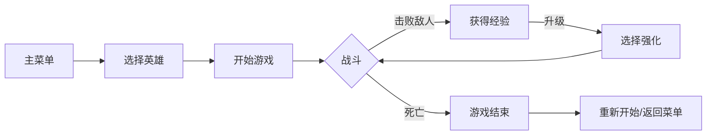

# 🎮 Survivors - Roguelite 生存游戏

<div align="center">

[](https://isocpp.org/)
[](https://www.qt.io/)
[](https://cmake.org/)
[](https://www.microsoft.com/windows)

**一款受《吸血鬼幸存者》启发的 C++ Roguelite 生存类游戏**

</div>

---

## 📖 游戏简介

**Survivors** 是一款使用 C++ 和 Qt6 框架开发的 Roguelite 风格生存游戏。玩家需要操控角色在无尽的怪物浪潮中存活，通过击杀敌人收集经验值来升级并选择不同的强化路线，挑战你的生存极限！

## ✨ 游戏特色

- 🎯 **经典 Roguelite 玩法** - 击败敌人获取经验，升级解锁强化选项
- 👥 **双英雄可选** - 两位风格迥异的英雄角色，带来不同的游戏体验
- ⚔️ **多样化武器系统** - AOE 技能、悬浮球、自动射击等多种攻击方式
- 🎨 **精美视觉效果** - 动态角色动画与流畅的游戏画面
- 🔧 **丰富的自定义选项** - 分辨率、音量、操控方式等多项设置

## 🦸 英雄角色

| 英雄 | 攻击方式 | 特点 |
|:---:|:---|:---|
| **哈气耄耋** | AOE 范围攻击 + 自动射击 | 以范围伤害为主，升级可扩大 AOE 范围 |
| **奔跑耄耋** | 悬浮球攻击 | 环绕型攻击方式，灵活多变 |

## 🎮 操作指南

### 基础操控
- **移动**: `W` `A` `S` `D` 键 或 鼠标控制（可在设置中切换）
- **动态模式**: `Ctrl + M` 切换英雄动态图片效果

### 游戏界面
- 📊 实时显示角色血量和经验条
- ❤️ 敌人血量可视化
- ⏸️ 左上角快捷功能：暂停 | 返回菜单 | 设置 | FPS 显示

## 🛠️ 技术栈

```
├── 语言        C++ 17
├── GUI 框架    Qt 6 (Widgets, Multimedia)
├── 构建系统    CMake 3.25+
└── 平台        Windows
```

## 📦 项目结构

```
Survivors/
├── Assets/           # 游戏资源（图片、音频等）
├── GameLogic/        # 游戏核心逻辑
│   ├── Hero.cpp/h        # 英雄角色
│   ├── Enemy.cpp/h       # 敌人系统
│   ├── Weapon.cpp/h      # 武器系统
│   ├── Bullet.cpp/h      # 子弹系统
│   ├── FloatingOrb.cpp/h # 悬浮球系统
│   └── ...
├── src/              # 主程序源码
│   ├── dialogs/          # 对话框（升级、设置、关于等）
│   ├── ui/               # UI 组件
│   └── gamemain.cpp/h    # 游戏主循环
├── CMakeLists.txt    # CMake 构建配置
└── build.bat         # Windows 一键构建脚本
```

## 🚀 构建与运行

### 环境要求
- Windows 操作系统
- CMake 3.25 或更高版本
- Qt 6（包含 Core, Gui, Widgets, Multimedia 组件）
- 支持 C++17 的编译器

### 构建步骤

```bash
# 1. 进入项目目录
cd Survivors

# 2. 使用构建脚本（推荐）
./build.bat

# 或手动构建
mkdir build && cd build
cmake ..
cmake --build . --config Release
```

### 直接运行
项目已包含预编译的可执行文件 `Survivors.exe`，可直接双击运行游戏！

## 📝 游戏流程



## 🎵 游戏资源

游戏包含丰富的视听资源：
- 🖼️ 精心设计的角色与敌人图像
- 🎶 沉浸式背景音乐
- 🗺️ 精美的游戏地图背景

---

<div align="center">

**🎮 准备好了吗？挑战你的生存极限！🎮**

</div>